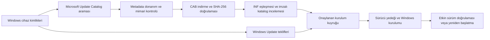

# Driver Booster incelemesi ve FromZero sürücü bulucu

6 Kasım 2026. İncelenen kurulum Driver Booster 14.0.1.462. REA 6.8.0, Node 24.22.1 ve Rizin 0.9.1 kullanıldı. Ana çalıştırılabilir dosyanın Windows Authenticode kontrolü geçerli sonuç verdi. İnceleme statik dosya, export, import ve seçili makine kodu okumalarını kapsar.

## Bulgular ve kanıtlar

| Parça | Gözlenen veri | Kanıt |
| --- | --- | --- |
| Kurulum dizini | 244 dizin kaydı, 68 dosya başlığı. Scanner.dll, DBDownloader.exe, DriverUpdate.exe, Backup.exe ve x86/x64 kurulum yardımcıları bulunuyor. | `ev_a279f374cbbcc95c2ae1f7fe3377d5d9cb5f10b20c5d675a1d67237c0d4c0e8b` |
| Tarama yaşam döngüsü | Scanner.dll `InitScan`, `SetParams`, `StartScan`, `StopScan`, `UpdateScan`, `FreeData` exportlarını içeriyor. | `ev_500f999e18c1345ba5ce4c1433f4b01328eb90ad2b2bd28f9ab26c0797dd99a2` |
| Tarama başlangıcı | `InitScan` VA `0x4b464c`, global hub adresi `0x4c2974` boşsa `TScanHandlerHub` oluşturuyor. `StartScan` VA `0x4b4854`, hub kontrolünden sonra `0x4b3d58` işlevine geçiyor. `SetParams` VA `0x4b4a10`, yapılandırma verisini hub içine kopyalıyor. | `ev_b760ebf8e13c17537c92c24df0f33c05075ce04a4b7cbc5f9f59d00363f1fff3` |
| Cihaz metadata adayları | Scanner.dll içinde `SetupDiEnumDeviceInfo` dosya ofseti `0x9eb6c`, `SetupDiGetDeviceRegistryPropertyW` `0x9eb98`, `CM_Get_DevNode_Status` `0x9f070`, `DriverVersion` `0xa1504`, `InfPath` `0xa1424` dizgeleri var. | Ofsetli `binary-strings.json`. SetupAPI adları doğrudan import değil. Aynı dosyanın LoadLibrary/GetProcAddress importları dinamik çözümleme olasılığını destekliyor. |
| Ağ katmanı | Scanner.dll ve DBDownloader.exe WinHTTP import ediyor. Her ikisinde `s1/s2.driverboosterscan.com/worker2.php` adresleri bulunuyor. Scanner.dll ofsetleri `0x2a94`, `0x2b64`. | Scanner import kaydı `ev_a4b691e9211bae3e020e00acc15e3a06cc14572f7dcf71036d85cd8feec6e9dd`, DBDownloader `ev_35ba039116846ad4f065fbcd06406afceae580f1bafb7d01bf2ede7a7bb85e6c0d3` |
| Paket kurulum yüzeyi | DbzInst.dll `InstallDbz`, `Is7zValid`, `CreateInstall`, `AbortInstall`, `FreeInstall` exportlarını içeriyor. | `ev_4e2cf1cc13746eb50c9be1431dc1d78a2f1ee84e8f87aefdf8f570f52594dfed` |
| Windows sürücü kurulumu | x64 dbinst.exe `newdev.dll!UpdateDriverForPlugAndPlayDevicesW` import ediyor. VA `0x730f40` konumundaki import geçidi bu adrese atlıyor. | Import `ev_88f1916132a9fad669d9072077d253215de3bfd0d60d39cb29e7a7bb85e6c0d3`, kod `ev_81af39a705fc4f85efa568f5def331a0154397f0c572d394a8e220f4678342e5` |
| Driver Store ve imza altyapısı | dpinst.exe `SetupDiBuildDriverInfoList`, `SetupDiGetDriverInfoDetailW`, `SetupDiCallClassInstaller`, `SetupCopyOEMInfW`, `CryptQueryObject` import ediyor. | `ev_ad06f8b53368617f710b4abc104686a2e313476dc35fea003b2697e0376cf2af` |

Kanıt kimlikleri REA'nın yerel JSON kayıtlarını tanımlar. Seçili özet [driver-booster-rea.json](evidence/driver-booster-rea.json) dosyasındadır. Tam kayıtlar geliştirme çalışma alanındaki `artifacts/private/driver-booster-rea` klasöründe tutulur.

İkinci native geçişte `StartScan → 0x4b3d58 → TScanHandler → TThread.Resume` zinciri çözümlendi. `0x4b14e0` yapılandırma aktarımı 3692 baytı işçiye kopyalıyor. Kanıtlar `ev_84ee4970ed431268b9354c60f72fd9a5950186477274fe67dd679d8682f8e61a` ve `ev_53a50545589878664d0af47ce03dadf4b38dbed5a0d01229bdba9a31f8e0bbe4`.

`InstallDbz` tarafında çıkarma yardımcısının dönüş değeri kontrol ediliyor. `drvinst.ini` dalından ilerleyen yardımcı kurucu kodunda `CreateProcessW → WaitForSingleObject → GetExitCodeProcess → CloseHandle` çağrıları doğrulandı. Kanıtlar `ev_e361d5524e5b9472afa96034c34a4c9dc2f1a926ebc88ce8b8d9c096a04f670c` ve `ev_b886d8c9c405ad126c5ab920828a182eb3951d9508af6eacd8a4d2a1c9110859`. Bu kod incelemesi kurucu başlatma/bekleme/sonuç toplama mantığını gösterir. Çalışan bir kurulum başarısı kaydı değildir.

`Is7zValid` gövdesi paketle gelen `7zTest.7z` ile arşiv bileşeni öz testi yapıyor. Üretici imzası doğrulaması olarak değerlendirilmedi.

## Kapsam ve açık kalan sorular

Statik veriler tarama, metadata, ağ erişimi ve Windows kurulum yardımcıları arasında katmanlı bir tasarımı destekliyor. Bir API importu veya dosya içindeki URL, o dalın çalışırken kullanıldığını tek başına kanıtlamaz.

Sunucuya gönderilen alanlar, yanıt şeması, sunucudaki bütün sürücü kataloğu, sürücü tercih ağırlıkları ve DBZ biçiminin tamamı bu incelemede elde edilmedi. Yerel SQLite dosyalarının bir kısmı başlangıç programlarının beyaz/kara listelerine ait. Bunlar bütün sürücü kataloğu olarak kullanılamaz. REA inspect araçları, istemcinin erişemediği sunucu verilerini üretmez.

IObit servisleriyle canlı istek/cevap kaydı alınmadı. Driver Booster üzerinden gerçek sürücü kurulumu veya geri alma çalıştırılmadı. Birebir katalog kapsamı doğrulanmış değildir.

## FromZero'daki bağımsız uygulama

- Güncellemeler içindeki **Driver finder / Sürücü bulucu** sekmesi gerçek Windows donanım kimlikleriyle arar. Donanım kartlarındaki arama düğmesi aynı akışı açar.
- Varsayılan **Sonuçlar** görünümü eski sürümleri, eksik oyun bileşenlerini, inceleme gereken cihazları ve güncel sürümleri tek listede gösterir. Kurulu ve mevcut sürüm, seçim kutusu, arama, durum ve kategori filtreleri bulunur. Üstte tek tarama, tüm uygun eksikleri seçme ve indirme/kurulum düğmeleri vardır.
- Microsoft Update Catalog sonuçları kaynak, sürüm, tarih, mimari ve eşleşen kimliği gösterir. Arama en fazla üç donanım kimliği ve 24 paket ayrıntısıyla sınırlıdır. Sonuçlar katalog kapsamının tamamını temsil etmez.
- İndirme adresleri resmi Microsoft sunucularıyla sınırlıdır. DownloadDialog SHA-256 kaydıyla dosyanın tamamı karşılaştırılır. CAB içerikleri yol, dosya sayısı, boyut ve çok parçalı arşiv sınırları açısından kontrol edilir.
- Açılan paketin INF dosyaları cihazın tam donanım kimliği, mimari, sınıf, sürüm ve katalog imzasıyla değerlendirilir. Eski/aynı sürüm, yanlış cihaz, doğrulanamayan imza ve firmware paketleri kuyruğa eklenemez.
- Kullanıcının incelediği paketler mevcut **Seçilenleri indir ve kur** kuyruğuna katılır. Kurulum öncesi cihaz ve paket yeniden kontrol edilir. Paket korumalı çalışma alanına alınır, sürücüler yedeklenir ve Windows PnPUtil çalıştırılır.
- Windows INF işletim sistemi süslemeleri, paket bütünlüğü ve sürücü sıralaması hakkında son kararı verir. Kurulumdan sonra etkin cihaz sürümü yeniden okunur. Depoya eklenip etkinleşmeyen paket başarı olarak gösterilmez.
- Ortadaki tarama ekranı FromZero renkleriyle yazılmış özgün bir piksel radardır. Gerçek işlem mesajını gösterir, tarama sürerken hareket eder ve bittiğinde kapanır. Sahte yüzde üretmez.

## Doğrulama

Canlı, salt okunur Microsoft Catalog denemesinde `PCI\VEN_10EC&DEV_8168&SUBSYS_337517AA&REV_1B` örneğiyle 12 metadata eşleşmesi döndü. `55e4c288-1590-4fed-b4c1-248ebd64da45` paketi indirildi. 598.115 baytlık CAB'ın SHA-256 değeri `E6CB34F14FF3365036F2AD2E1D26BB03A986A00D41C868D3A78853230E7DBD6F` olarak doğrulandı. `rt640x64.inf` ve `rt640x64.cat` çıkarıldı, INF donanım eşleşmesi geçti. Üretim inceleme akışında katalog imzası Windows tarafından `Microsoft Windows Hardware Compatibility Publisher` olarak doğrulandı ve örnek INF kuruluma uygun bulundu.

Otomatik kontroller yanlış mimari/kimlik, eski sürüm, firmware, eksik imza, kaynak kimliği, CAB yol taşması, ayrılmış Windows dosya adları ve imzalı CAB son eklerini kapsar. Geliştirme bilgisayarında yeni sürücü kurulumu çalıştırılmadı. Radar ayrı bir WPF görseli olarak oluşturulup incelendi. Canlı arayüz otomasyonu, bu oturumda araç çalışma alanı hatası nedeniyle kullanılamadı.

## Kaynaklar

- [REA desktop inspection](https://github.com/morluto/rea/blob/main/docs/desktop-applications.md)
- [REA PE import inspection](https://github.com/morluto/rea/blob/main/docs/pe-imports.md)
- [REA Rizin workflow](https://github.com/morluto/rea/blob/main/docs/reverse-engineering-tools.md)
- [Microsoft Update Catalog](https://www.catalog.update.microsoft.com/)
- [Microsoft PnPUtil komutları](https://learn.microsoft.com/en-us/windows-hardware/drivers/devtest/pnputil-command-syntax)
